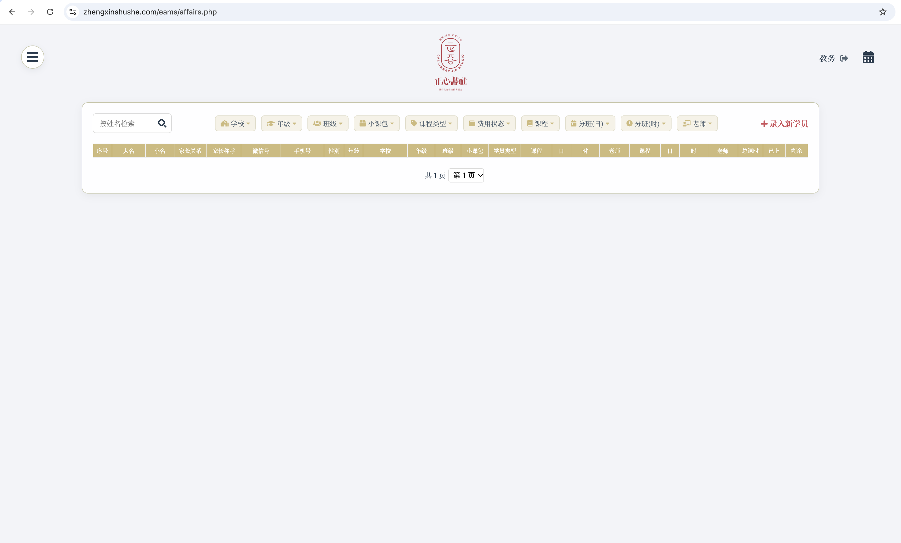
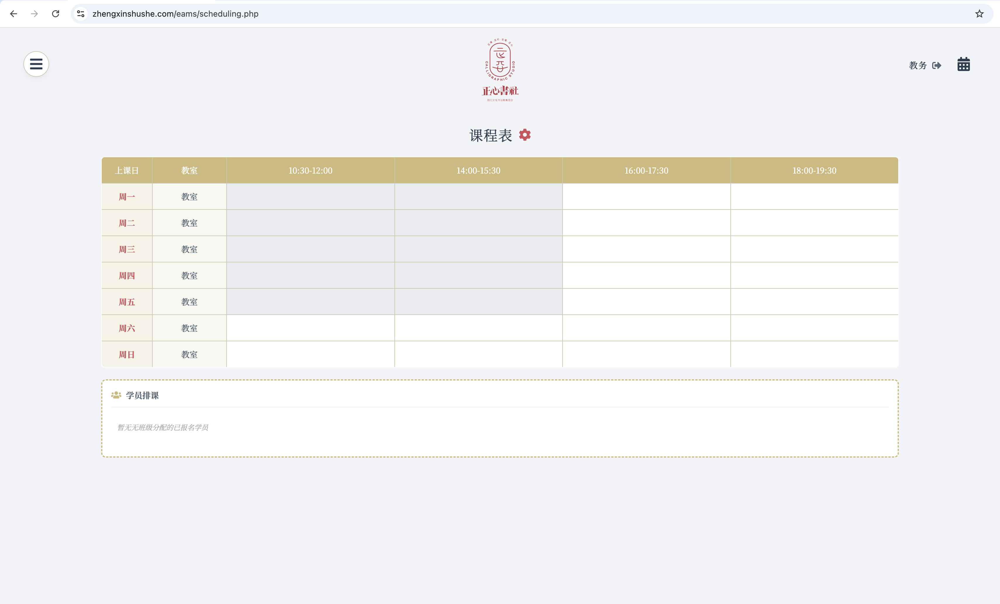
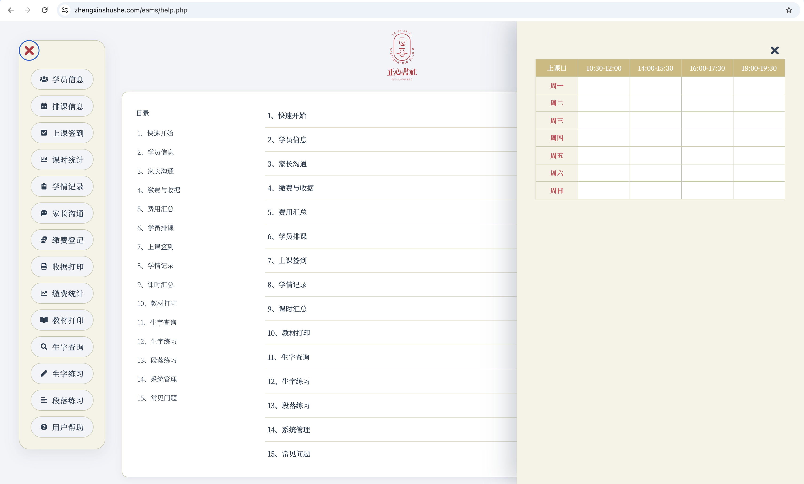
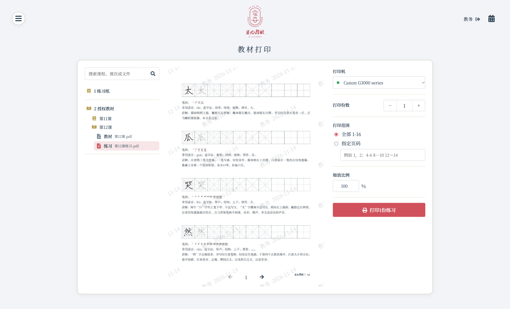
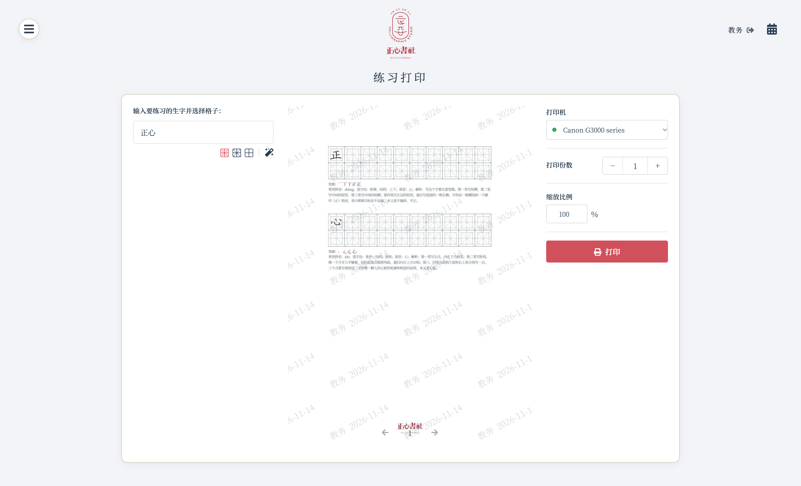
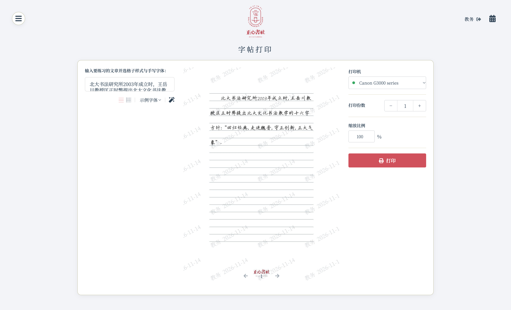
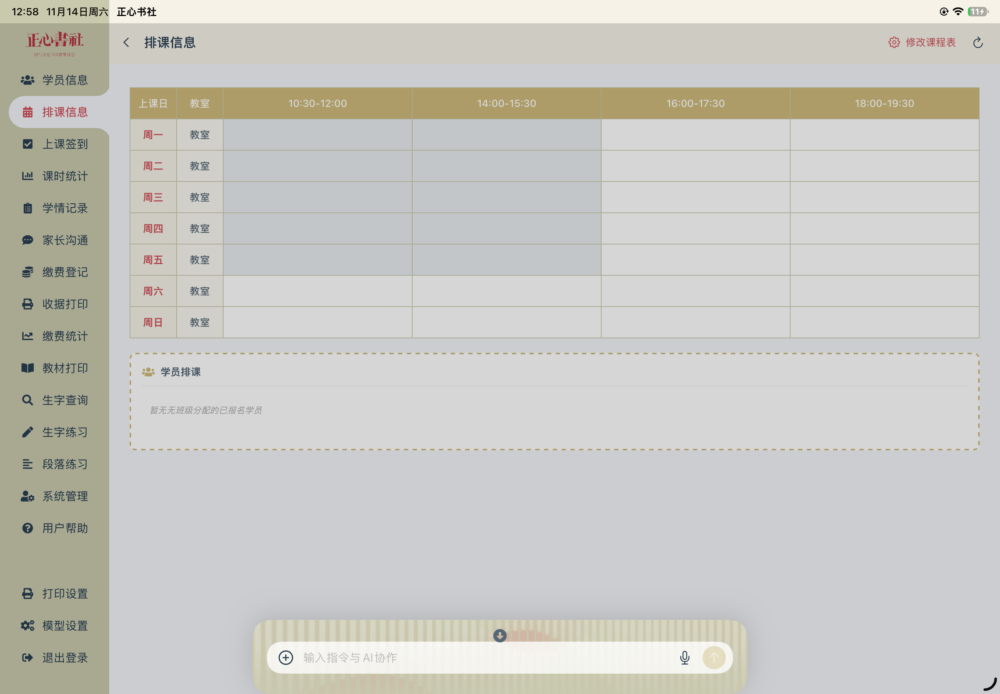
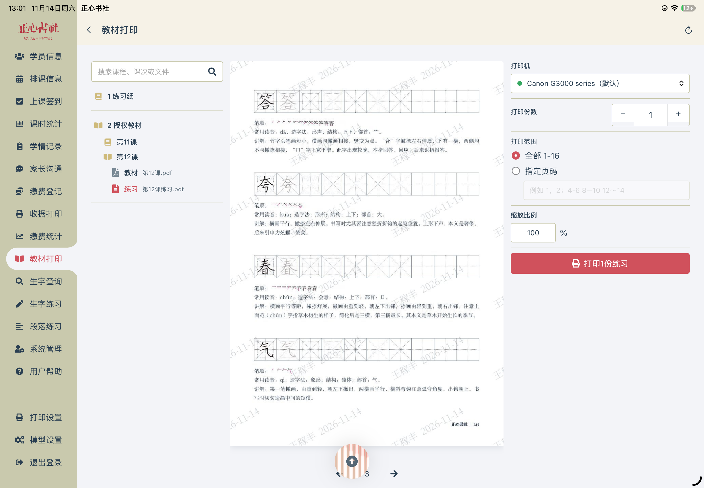
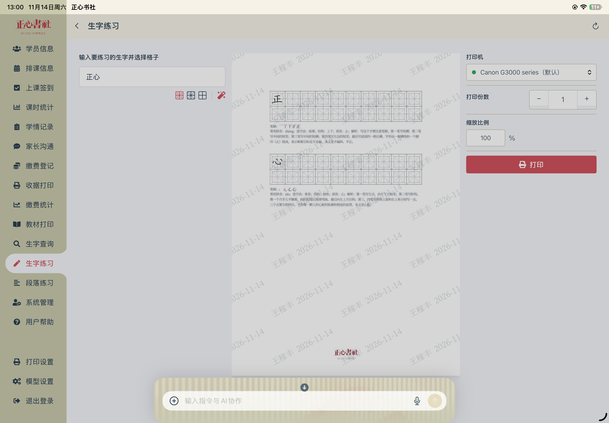

# 正心EAMS教务管理系统（Educational Affairs Management System）

**GitHub 仓库名：** `eams`

正心EAMS教务管理系统面向小型教育机构，帮助机构管理从学员报名、排课、签到到课时统计、家长沟通和费用登记的日常工作。授权发布版本还具有直连打印、教材管理等功能，以及生字练习等专用于硬笔规范书写的内容。

系统以自建 PHP Web 服务为核心，并提供 iOS、Android 和微信小程序客户端。

iOS、Android 客户端还内置了AI，提供了操作管理、业务咨询等功能。

- web界面

  

  

  

  

  

  

- ios界面

  

  

  

  

**项目官网：**

- 项目官网：[https://www.zhengxinshushe.com/eams](https://www.zhengxinshushe.com/eams)

- 项目演示：[https://www.zhengxinshushe.com/eams/login.php](https://www.zhengxinshushe.com/eams/login.php)

  | 角色 | 账户      | 密码      |
  | ---- | --------- | --------- |
  | 教学 | `teaher1` | `teaher1` |
  | 教务 | `teaher2` | `teaher2` |
  | 招生 | `teaher3` | `teaher3` |

- 用户帮助：https://zhengxinshushe.com/eams/help.php

  请使用演示账号登录后查看。

## 客户端

- **Web 系统：**通过浏览器访问，支持本机、机构局域网或服务器部署。
- **iOS 客户端：**适用于 iPhone 和 iPad，输入IP或网址、用户名、密码即可连接使用，具有直连打印机、AI操作的功能。
- **Android 客户端：**适用于 Android 手机和平板，输入IP或网址、用户名、密码即可连接使用，具有直连打印机、AI操作的功能。
- **微信小程序：**微信端入口，输入IP或网址、用户名、密码即可连接使用。

客户端的下载及使用请参阅官网说明。

## 主要功能

- **学员管理：**学员档案、报名信息、家长资料、学习情况及课时、费用等。
- **排课与签到：**课程表、教室和时段设置、课程调整、快捷签到及上课记录。
- **课时与费用：**缴费登记、收据、费用汇总和剩余课时查询。
- **沟通与学情：**家长沟通记录、附件、课堂表现、练习记录及相关图片。
- **系统管理：**仅管理员可用，进行机构个性化设置、用户管理、数据库备份并可查看操作日志。
- **其他内容：**教材打印、生字查询与练习生成等功能需要单独授权。

## 技术与部署

EAMS系统提供本地与服务器两种公开部署包，可按机构情况选择在单机、局域网或服务器环境中部署使用，请根据需要下载。

| 文件 | 用途 | 备注 |
|---|---|---|
| `eams_localhost_v1_20261111.7z` | 本地部署候选包 | 适用于本机使用或局域网内使用 |
| `eams_server_v1_20261111.7z` | 服务器部署候选包 | 需要解析域名并配置SSL证书 |

EAMS系统采用 PHP和 MySQL/MariaDB，发布包 Composer 元数据要求 PHP `>=8.2.0 <8.6.0`，并包含 TCPDF、PDF Parser 等依赖；运行create.php进行安装时会核对环境和依赖，缺失的按提示修改即可。

EAMS系统官网内提供了 deploy-eams-skill，您可以使用此skill进行AI部署。

## 授权与安全

教务系统本身的代码和内容按 **CC-BY-ND-4.0（署名-禁止演绎 4.0 国际）**授权。您可以复制和再发布教务系统本身的内容，包括商业用途，但须给予适当署名并附上许可证链接、不得分发修改后的演绎版本。完整条款见[Creative Commons 官方许可页](https://creativecommons.org/licenses/by-nd/4.0/)。

教务系统中使用的第三方代码、字体及其他资源不包含在本项目许可内，仍遵循各自原有授权协议。

## 第三方开源代码

以下组件已在上述候选部署包中核对；第三方许可证不决定本项目自有代码的许可证。

| 项目 | 源地址 | 协议 |
|---|---|---|
| Font Awesome Free 5.15.4 | [GitHub](https://github.com/FortAwesome/Font-Awesome) | 图标 CC BY 4.0；图标字体 SIL OFL 1.1；代码 MIT |
| JSZip 3.1.5 | [GitHub](https://github.com/Stuk/jszip) | MIT 或 GPL-3.0；内含 Pako（MIT） |
| Mozilla PDF.js | [GitHub](https://github.com/mozilla/pdf.js) | Apache-2.0 |
| Plyr | [GitHub](https://github.com/sampotts/plyr) | MIT |
| TCPDF 6.11.3 | [GitHub](https://github.com/tecnickcom/TCPDF) | LGPL-3.0-or-later |
| PDF Parser 2.12.5 | [GitHub](https://github.com/smalot/pdfparser) | LGPL-3.0 |
| composer/pcre 3.4.0 | [GitHub](https://github.com/composer/pcre) | MIT |
| ZipStream-PHP 3.1.2 | [GitHub](https://github.com/maennchen/ZipStream-PHP) | MIT |
| PHPComplex 3.0.2 | [GitHub](https://github.com/MarkBaker/PHPComplex) | MIT |
| PHPMatrix 3.0.1 | [GitHub](https://github.com/MarkBaker/PHPMatrix) | MIT |
| PSR Simple Cache 3.0.0 | [GitHub](https://github.com/php-fig/simple-cache) | MIT |
| Symfony Polyfill Mbstring 1.38.2 | [GitHub](https://github.com/symfony/polyfill-mbstring) | MIT |

本项目仅使用了思源宋体、思源黑体及方正书宋、方正仿宋、方正楷体、方正黑体、京華老宋体等可以免费商用的字体。

## 获取帮助

请访问[项目官网](https://www.zhengxinshushe.com/eams)，查看当前版本的下载、部署和用户帮助资料。

如需支持，请通过官网公布的渠道联系。
